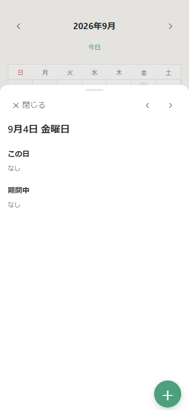
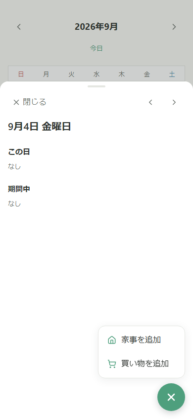
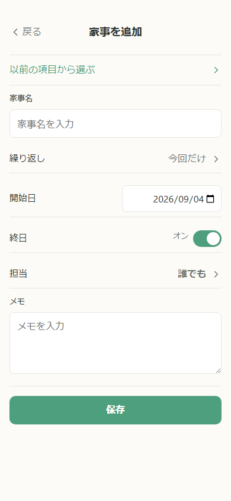
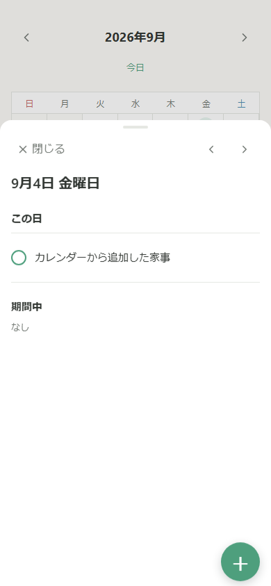
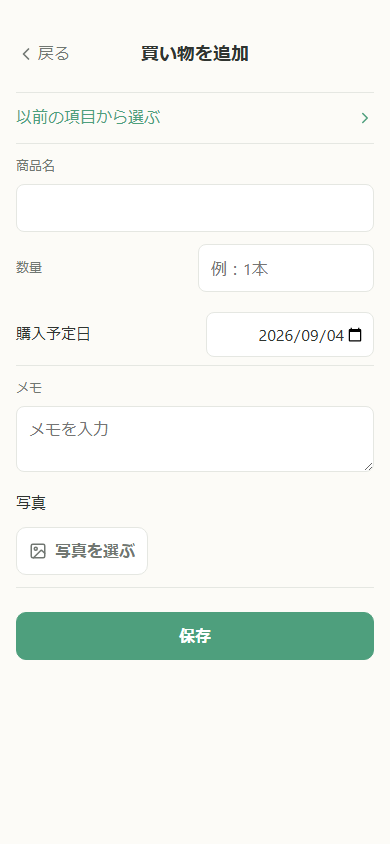
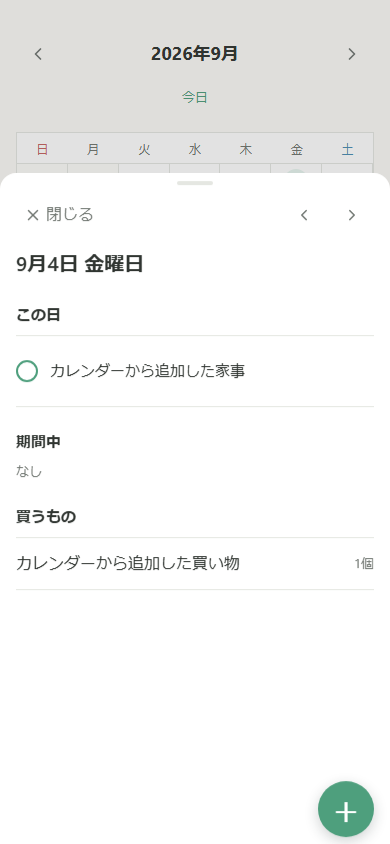

# Calendar 日付詳細クイック追加

Calendar の日付詳細パネルに、その日付を初期値として家事・買い物を追加できる軽量な quick-add menu を追加しました。

## Evidence

## 実装メモ

- 右下の 56px 円形 primary ボタンは日付詳細シート内に固定し、safe-area とスクロール下部 padding を考慮しています。
- ＋の上に `role="menu"` の小さな popover を表示し、家事・買い物の選択で閉じます。再タップ、メニュー外タップ、日付移動、シート終了でも閉じます。
- フォームへは既存 `returnTo` に加えて `date`、`origin=calendar`、`calendarDate` を query で渡します。不正な `date` は通常のフォーム初期値へフォールバックします。
- 保存前に対象日の Calendar range/day snapshot を既存方式で無効化し、戻り先で最新データを取得します。

## 検証

- `npm run lint`
- `npm run typecheck`
- `npm test -- --reporter=dot`
- `npm run build`
- `npm run cf:validate:staging`
- `npm run cf:deploy:staging:dry-run`
- Calendar quick-add Playwright: 2 passed at 390×844
- Existing returnTo regression: 3 passed
- Existing Calendar Date Sheet regression: 13 passed

Staging deploy and smoke results are added to this PR after deployment. Production/default and migrations are untouched; this PR is not merged.
