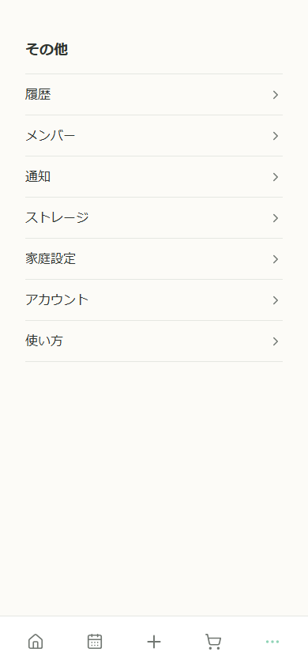
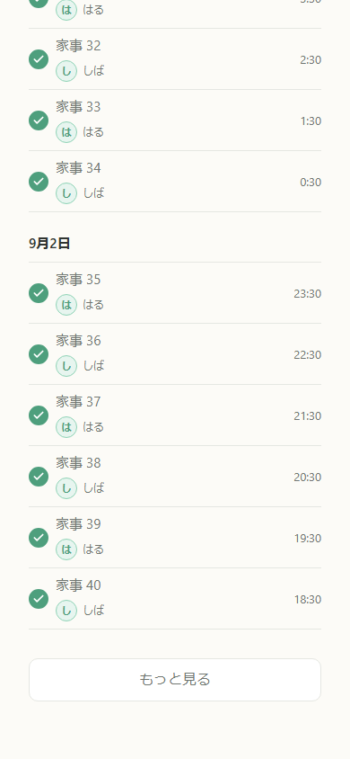
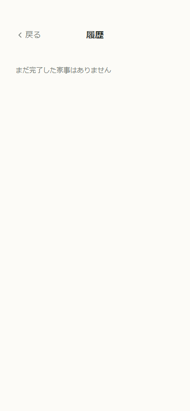
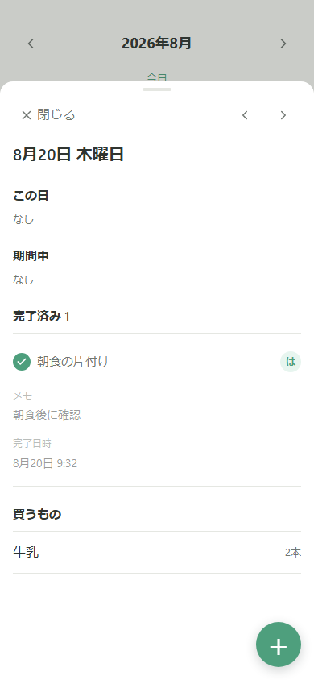
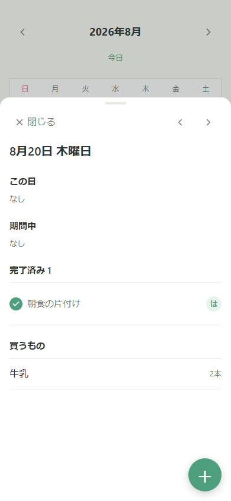
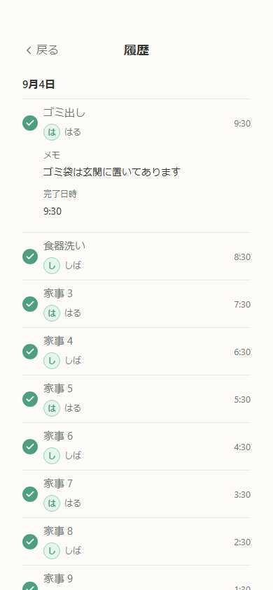
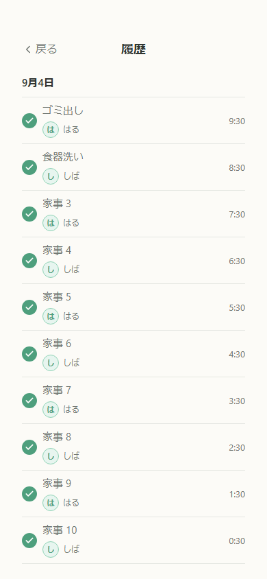

# 家庭全体の完了履歴 Evidence

390×844 の Chromium Playwright fixture で取得した UI Evidence です。API fixture は家庭内の完了記録だけを返し、2ページ目を cursor で返しています。

「その他」に「履歴」が設定系項目より上に追加されています。

履歴は completedAt の新しい順で、家庭の timezone（Asia/Tokyo）による日付グループ、円形 Check、タイトル、実際の完了者、時刻を表示します。

大量履歴では明示的な「もっと見る」ボタンを表示します。

履歴がない場合は「まだ完了した家事はありません」を表示します。

Calendarの完了履歴行をタップすると、完了時点のメモと household timezone の完了日時を展開します。

その他の履歴も同じ行内でメモを確認できます。再タップで閉じます。

## 検証

- `e2e/household-completed-history.spec.ts`
- `npm run typecheck`
- `npm run lint`
- `npm run build`
- `npm test -- --run worker/app.test.ts src/App.test.tsx`
- `npx playwright test e2e/calendar-m3.spec.ts e2e/household-completed-history.spec.ts`
