## Summary

Production Calendar M3 review follow-up. The implementation and Evidence now address the reviewer findings for action state separation, settled refreshes, Mockup motion/copy parity, calendar scope validation, inactive flexible legacy history, and deterministic reviewer uploads.

## Scope

- PR-body visual gallery for the 390×844 Production / Mockup comparison states.
- Four canonical WebM recordings regenerated after the review fixes, with animated GIF review previews derived at 10 fps without slowing playback.
- SHA-pinned GitHub raw/blob URLs so the gallery does not depend on the branch name.
- Clean reviewer upload package containing four labeled side-by-side boards and the four canonical WebM files only.

## Mockup reference SHA

`db8941dc3056f07862014242a349ae366da59e9c`

## Visual Evidence

### Mockup Parity Gallery

Images are pinned to the final Evidence commit. Click either image to open the original 390×844 PNG.

### Calendar normal

| Production | Mockup |
| --- | --- |
| <a href="https://github.com/427harinn/HouseToDo/blob/0e3f3e90cd31c9bf30e3fcc93328bdd52bd397cd/docs/evidence/m3/production/01-calendar-normal.png">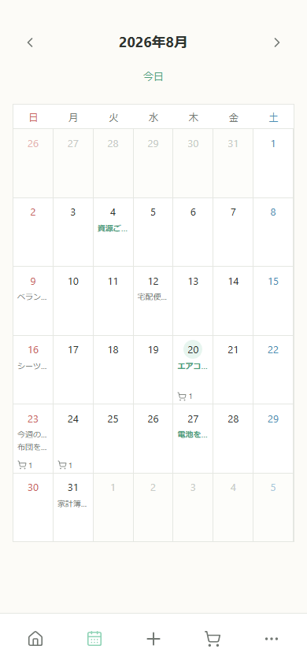</a> | <a href="https://github.com/427harinn/HouseToDo/blob/0e3f3e90cd31c9bf30e3fcc93328bdd52bd397cd/docs/evidence/m3/mockup/01-calendar-normal.png">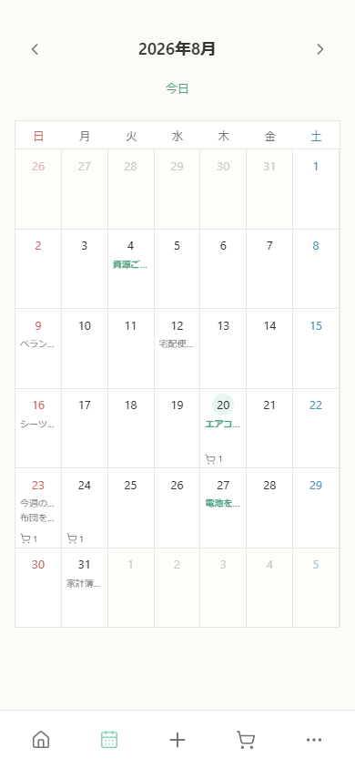</a> |

### Calendar dense

| Production | Mockup |
| --- | --- |
| <a href="https://github.com/427harinn/HouseToDo/blob/0e3f3e90cd31c9bf30e3fcc93328bdd52bd397cd/docs/evidence/m3/production/02-calendar-dense.png">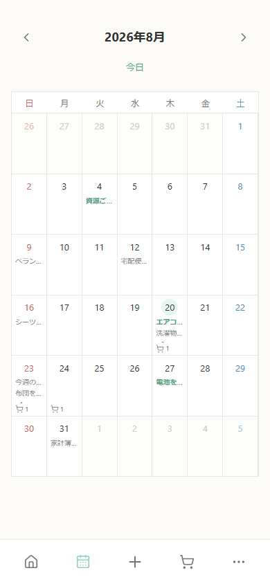</a> | <a href="https://github.com/427harinn/HouseToDo/blob/0e3f3e90cd31c9bf30e3fcc93328bdd52bd397cd/docs/evidence/m3/mockup/02-calendar-dense.png">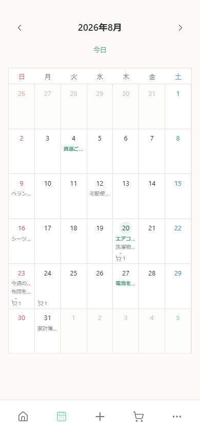</a> |

### Calendar Shopping

| Production | Mockup |
| --- | --- |
|  |  |

### Date Sheet normal

| Production | Mockup |
| --- | --- |
|  |  |

### Date Sheet period + Shopping

| Production | Mockup |
| --- | --- |
| <a href="https://github.com/427harinn/HouseToDo/blob/0e3f3e90cd31c9bf30e3fcc93328bdd52bd397cd/docs/evidence/m3/production/05-calendar-date-period-shopping.png">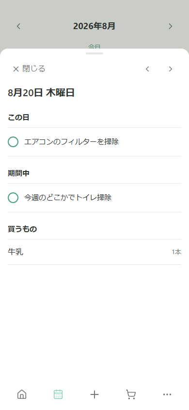</a> |  |

### Completed collapsed

| Production | Mockup |
| --- | --- |
| <a href="https://github.com/427harinn/HouseToDo/blob/0e3f3e90cd31c9bf30e3fcc93328bdd52bd397cd/docs/evidence/m3/production/06-calendar-completed-collapsed.png">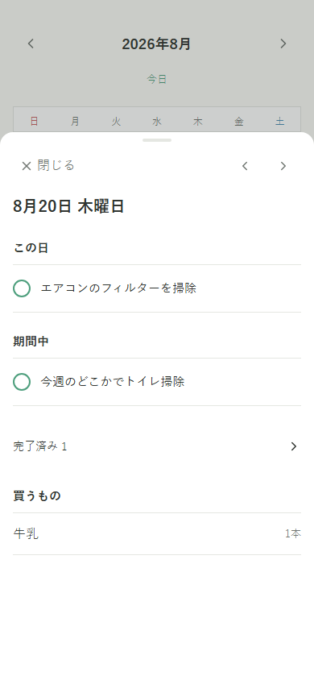</a> | <a href="https://github.com/427harinn/HouseToDo/blob/0e3f3e90cd31c9bf30e3fcc93328bdd52bd397cd/docs/evidence/m3/mockup/06-calendar-completed-collapsed.png">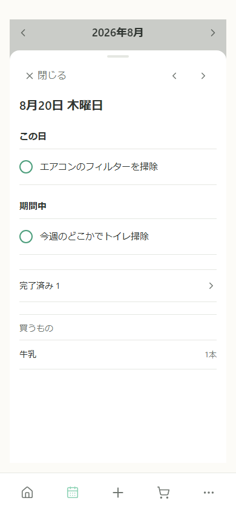</a> |

### Completed open

| Production | Mockup |
| --- | --- |
| <a href="https://github.com/427harinn/HouseToDo/blob/0e3f3e90cd31c9bf30e3fcc93328bdd52bd397cd/docs/evidence/m3/production/07-calendar-completed-open.png">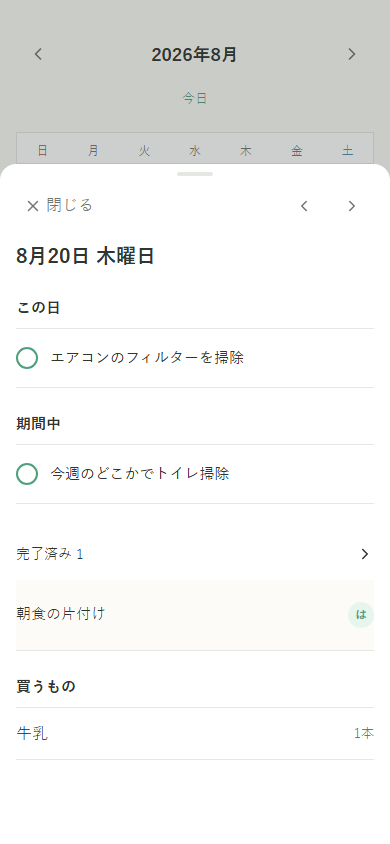</a> | <a href="https://github.com/427harinn/HouseToDo/blob/0e3f3e90cd31c9bf30e3fcc93328bdd52bd397cd/docs/evidence/m3/mockup/07-calendar-completed-open.png">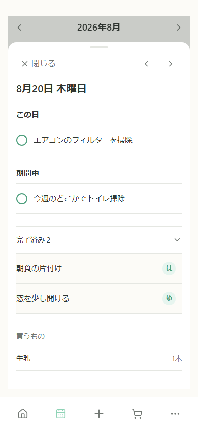</a> |

### Completed swipe

| Production | Mockup |
| --- | --- |
| <a href="https://github.com/427harinn/HouseToDo/blob/0e3f3e90cd31c9bf30e3fcc93328bdd52bd397cd/docs/evidence/m3/production/08-calendar-completed-swipe.png">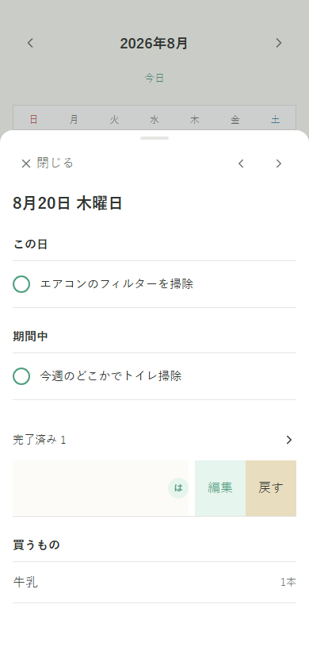</a> | <a href="https://github.com/427harinn/HouseToDo/blob/0e3f3e90cd31c9bf30e3fcc93328bdd52bd397cd/docs/evidence/m3/mockup/08-calendar-completed-swipe.png">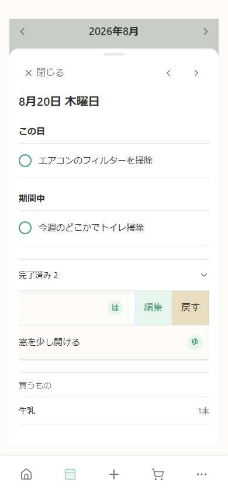</a> |

### Deleted completed restore-only

| Production | Mockup |
| --- | --- |
| <a href="https://github.com/427harinn/HouseToDo/blob/0e3f3e90cd31c9bf30e3fcc93328bdd52bd397cd/docs/evidence/m3/production/09-calendar-deleted-completed-restore-only.png">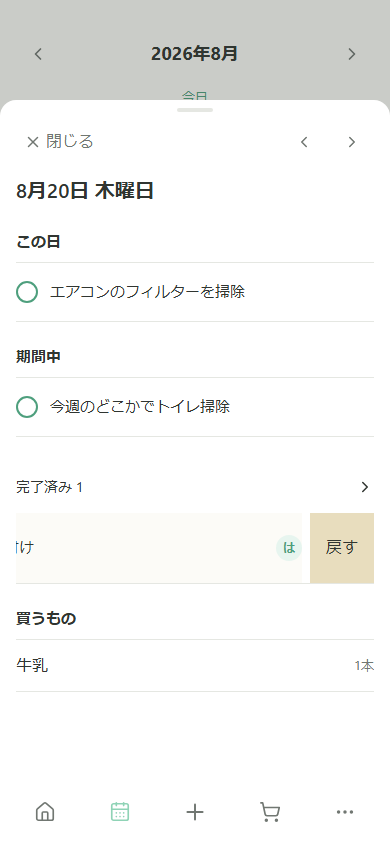</a> | <a href="https://github.com/427harinn/HouseToDo/blob/0e3f3e90cd31c9bf30e3fcc93328bdd52bd397cd/docs/evidence/m3/mockup/09-calendar-deleted-completed-restore-only.png">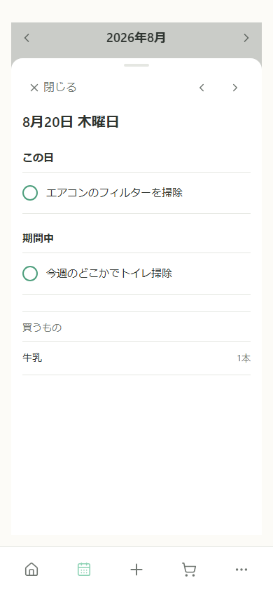</a> |

### After restore

| Production | Mockup |
| --- | --- |
| <a href="https://github.com/427harinn/HouseToDo/blob/0e3f3e90cd31c9bf30e3fcc93328bdd52bd397cd/docs/evidence/m3/production/10-calendar-after-restore.png">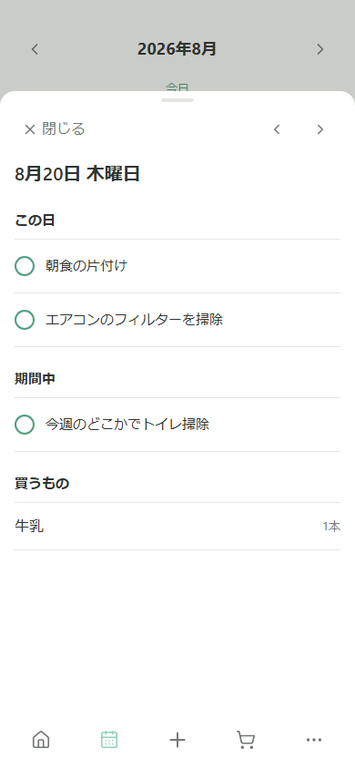</a> |  |

### Next month

| Production | Mockup |
| --- | --- |
| <a href="https://github.com/427harinn/HouseToDo/blob/0e3f3e90cd31c9bf30e3fcc93328bdd52bd397cd/docs/evidence/m3/production/11-calendar-next-month.png">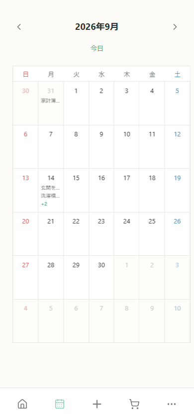</a> | <a href="https://github.com/427harinn/HouseToDo/blob/0e3f3e90cd31c9bf30e3fcc93328bdd52bd397cd/docs/evidence/m3/mockup/11-calendar-next-month.png">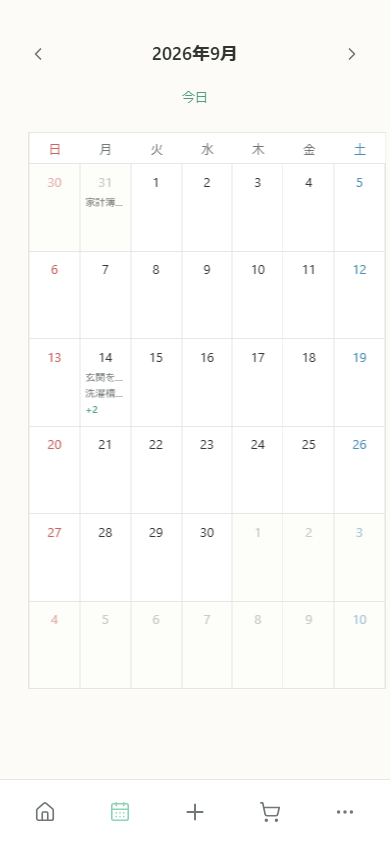</a> |

### Production-only task edit return context

<a href="https://github.com/427harinn/HouseToDo/blob/0e3f3e90cd31c9bf30e3fcc93328bdd52bd397cd/docs/evidence/m3/production/12-calendar-task-edit-return-context.png">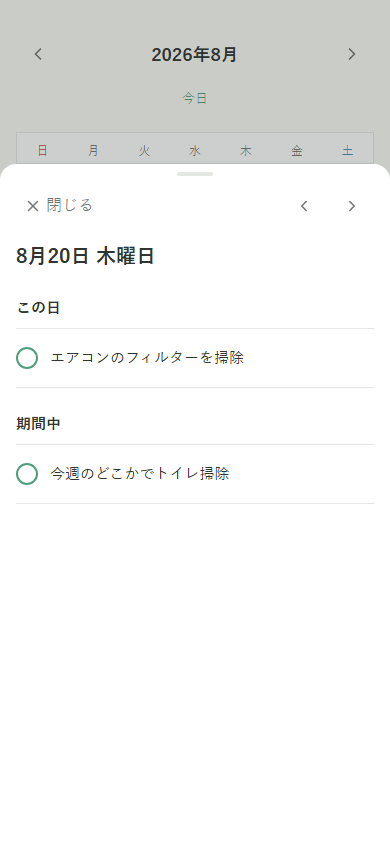</a>

## Motion Evidence

GIFs are review previews generated from the updated canonical WebM at 10 fps without slowing playback. The original WebM remains the canonical Motion evidence.

### Task completion

Original WebM: [calendar-task-complete.webm](https://github.com/427harinn/HouseToDo/blob/0e3f3e90cd31c9bf30e3fcc93328bdd52bd397cd/docs/evidence/m3/motion/calendar-task-complete.webm)

### Month swipe

Original WebM: [calendar-month-swipe.webm](https://github.com/427harinn/HouseToDo/blob/0e3f3e90cd31c9bf30e3fcc93328bdd52bd397cd/docs/evidence/m3/motion/calendar-month-swipe.webm)

### Day swipe

Original WebM: [calendar-day-swipe.webm](https://github.com/427harinn/HouseToDo/blob/0e3f3e90cd31c9bf30e3fcc93328bdd52bd397cd/docs/evidence/m3/motion/calendar-day-swipe.webm)

### Completed undo

<a href="https://github.com/427harinn/HouseToDo/blob/0e3f3e90cd31c9bf30e3fcc93328bdd52bd397cd/docs/evidence/m3/motion/previews/calendar-completed-undo.gif">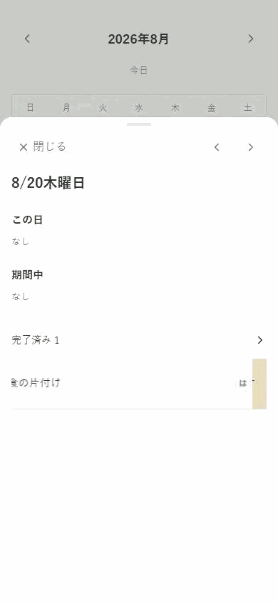</a>

Original WebM: [calendar-completed-undo.webm](https://github.com/427harinn/HouseToDo/blob/0e3f3e90cd31c9bf30e3fcc93328bdd52bd397cd/docs/evidence/m3/motion/calendar-completed-undo.webm)

## Reviewer upload package

The clean manual-upload package is pinned to `1ac34e5` and contains exactly eight files: four labeled comparison boards and four canonical WebM files. It contains no individual screenshots, GIFs, or intermediate frames.

- Boards: [01-month-views.png](https://github.com/427harinn/HouseToDo/blob/1ac34e5/docs/evidence/m3/review-upload/01-month-views.png), [02-date-sheet.png](https://github.com/427harinn/HouseToDo/blob/1ac34e5/docs/evidence/m3/review-upload/02-date-sheet.png), [03-history-actions.png](https://github.com/427harinn/HouseToDo/blob/1ac34e5/docs/evidence/m3/review-upload/03-history-actions.png), [04-task-edit-return-context.png](https://github.com/427harinn/HouseToDo/blob/1ac34e5/docs/evidence/m3/review-upload/04-task-edit-return-context.png)
- WebM: [calendar-task-complete.webm](https://github.com/427harinn/HouseToDo/blob/1ac34e5/docs/evidence/m3/review-upload/calendar-task-complete.webm), [calendar-month-swipe.webm](https://github.com/427harinn/HouseToDo/blob/1ac34e5/docs/evidence/m3/review-upload/calendar-month-swipe.webm), [calendar-day-swipe.webm](https://github.com/427harinn/HouseToDo/blob/1ac34e5/docs/evidence/m3/review-upload/calendar-day-swipe.webm), [calendar-completed-undo.webm](https://github.com/427harinn/HouseToDo/blob/1ac34e5/docs/evidence/m3/review-upload/calendar-completed-undo.webm)

## Mockup Parity Audit

All shared states above were re-rendered side-by-side at 390×844 from the latest Production code and Mockup fixtures. Production-only differences are real API loading/error/accessibility fallbacks; no unexplained parity deviation was introduced.

## Tests / verification

- Evidence files exist at the pinned SHA and are referenced with GitHub raw/blob URLs.
- PNGs are settled 390×844 captures; dense, completed-swipe, deleted restore-only, and next-month states use their asserted semantic fixtures.
- GIFs are 10 fps previews derived from the updated WebM recordings without slowing playback.
- WebM originals were re-recorded after the review fixes; GIFs were regenerated from those recordings.
- `review-upload/` was cleared before generation and contains exactly four boards plus four WebM files.

## Artifact details

- PNG source: `docs/evidence/m3/production/` and `docs/evidence/m3/mockup/`
- GIF previews: `docs/evidence/m3/motion/previews/`
- Canonical WebM: `docs/evidence/m3/motion/`
- Reviewer upload package: `docs/evidence/m3/review-upload/`
- No npm runtime dependency was added.
- Calendar implementation changes are limited to the review findings; no M4 Shopping UI migration was included.

## Deploy status

No Cloudflare deploy, remote D1 migration, staging DB change, secret change, or production mutation was performed.
