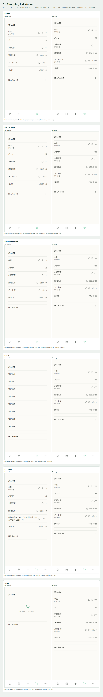
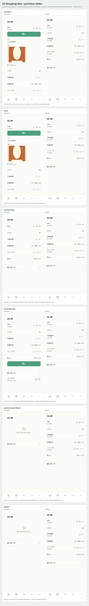

## Summary

M4 Shopping migration is complete on `feat/production-shopping-m4`. The Production Shopping list, Add, and Edit flows now follow HouseToDo-Mockup latest main for layout, copy, visible states, gestures, and motion while retaining Production API, auth, household authorization, D1, R2, and Calendar/Home semantics.

## Scope

- Flat Shopping rows with oldest-first fallback, one-row expand/collapse, memo/photo indicators, planned date, purchased section, purchaser/time/avatar, purchase/restore, and seven-day purchased visibility without deleting data.
- Real pointer swipe to `編集` only; delete remains in Edit confirmation. Long-press drag reorder persists shared household order.
- Canonical `/shopping/new` and existing Edit route form, unified reuse search, optional quantity/planned date, preserved OS image picker/validation/compression/R2 flow, and Edit-only delete confirmation.
- Calendar deep-link target handling and Home pending Shopping count regression coverage.

## Production base SHA

`485dbfefd93d16d1ae1abd60f849918703d4657c`

## Mockup reference SHA

`db8941dc3056f07862014242a349ae366da59e9c`

## Backend contract

Added `POST /api/shopping/items/reorder` with `{ itemIds: string[] }`. The Worker validates a non-duplicated list, scopes it to the authenticated household, requires the exact current pending-item set, and persists sequential `shopping_items.sort_order` values. Stale, unknown, or cross-household IDs return a conflict. Existing `sort_order` was sufficient; no migration was added. Existing template routes remain for compatibility and M7 cleanup.

## Visual Evidence

Evidence commit: `5fd4cb14190a28ab663ceb123056fe5a3955fc71`

Boards are labeled with state name, Production render target SHA `651363dd5700adfb18ce1a8608c7ee60ea999f91`, Mockup SHA, and Evidence source. All captures are settled 390×844 renders.

## Motion Evidence

GIF previews are derived from the canonical WebM recordings without changing playback timing:

[Canonical WebM: shopping-expand-collapse.webm](https://github.com/427harinn/HouseToDo/blob/5fd4cb14190a28ab663ceb123056fe5a3955fc71/docs/evidence/m4/motion/shopping-expand-collapse.webm)

[Canonical WebM: shopping-purchase-restore.webm](https://github.com/427harinn/HouseToDo/blob/5fd4cb14190a28ab663ceb123056fe5a3955fc71/docs/evidence/m4/motion/shopping-purchase-restore.webm)

[Canonical WebM: shopping-swipe-edit.webm](https://github.com/427harinn/HouseToDo/blob/5fd4cb14190a28ab663ceb123056fe5a3955fc71/docs/evidence/m4/motion/shopping-swipe-edit.webm)

[Canonical WebM: shopping-reorder.webm](https://github.com/427harinn/HouseToDo/blob/5fd4cb14190a28ab663ceb123056fe5a3955fc71/docs/evidence/m4/motion/shopping-reorder.webm)

## Deviations

- Production keeps legacy Shopping template endpoints/routes and backend compatibility; the new primary flow presents one unified reuse search rather than Recent/Template sections. M7 owns cleanup.
- Production keeps its existing image validation, compression, R2 ownership, attachment limits, and storage checks. The canonical form does not expose camera/library-specific buttons or storage metrics, so the existing single OS file picker behavior remains without adding visible non-canonical controls.
- Production evidence uses a deterministic review-only API fixture to render authenticated data states; the fixture is not shipped into business logic. Real API/auth/permission/D1/R2 behavior remains the Production source of truth.

## Tests

- `npm run lint` — passed
- `npm run typecheck` — passed
- `npm test` — passed
- `npm run build` — passed
- Targeted Worker reorder API test — passed, including stale/cross-household rejection and reload persistence
- Targeted App Shopping tests — passed (20 tests)
- Deterministic purchased visibility test — passed at the exact seven-day boundary
- Playwright M4 evidence capture — passed at 390×844; exercised tap expand/collapse, purchase/restore, real pointer swipe, real long-press reorder, reuse picker, photo selection, edit, and delete confirmation. Browser capture completed without reported page errors.

## Reviewer upload package

`docs/evidence/m4/review-upload/` contains exactly eight files: four labeled boards and four canonical WebM recordings. GIFs, individual captures, intermediate frames, traces, and reports are excluded.

## Deploy status

- staging deploy: not performed
- production deploy: not performed
- remote migration: not performed
- secrets/Cron: untouched
- PR merge: not performed
