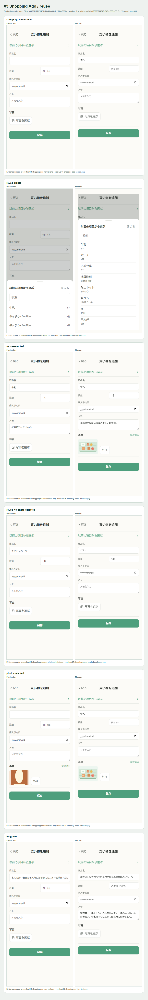
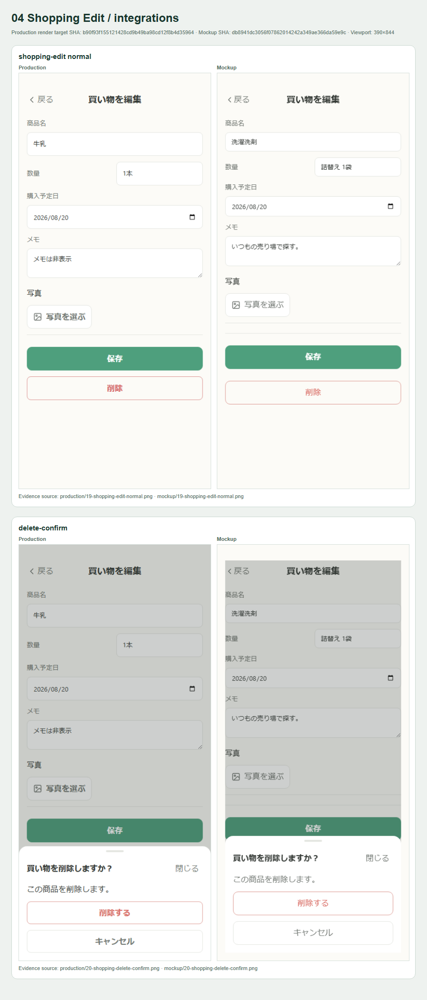
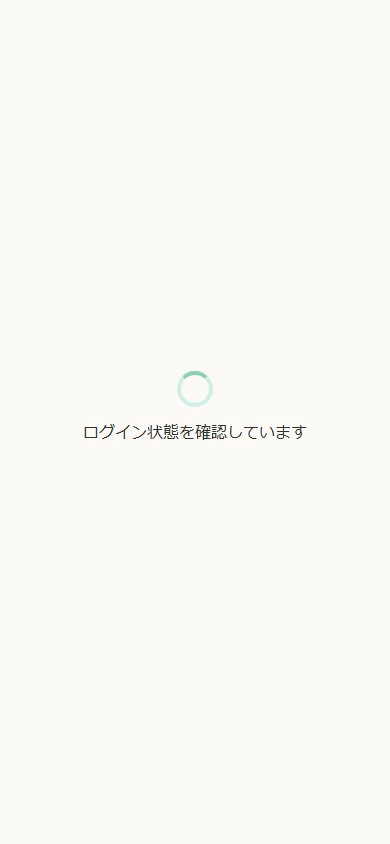

## Summary

PR #5 updates the M4 Shopping migration on `feat/production-shopping-m4`. The review corrections fix Mockup state routing/assertions, align the Production/Mockup semantic review fixtures, and make long-press reorder complete reliably with actual pointer input while preserving Production API, auth, household authorization, D1, R2, Calendar, and Home contracts.

## Scope

- Correct canonical `uilabState` routing for all 20 Mockup screenshots with DOM semantic assertions before capture.
- Re-captured 20 Production and 20 Mockup states at 390×844, including planned/no-date, quantity-empty, photo, purchased filtering, reuse, and Edit delete confirmation semantics.
- Aligned Shopping Add/Edit photo controls to the Mockup thumbnail treatment and matched delete-confirmation action styling without changing picker, upload, ownership, or delete behavior.
- Added pointer capture and a window-level pointerup fallback for long-press drag reorder. Evidence asserts oldest-first initial order, actual pointer drag, visible DOM order change, reorder API response, and reload persistence.
- Kept swipe as `編集` only, delete in Edit only, and preserved the existing image picker, validation, compression, attachment limits, R2 ownership, and cleanup behavior.

## Production base SHA

`485dbfefd93d16d1ae1abd60f849918703d4657c`

## Mockup reference SHA

`db8941dc3056f07862014242a349ae366da59e9c`

## Backend contract

M4 retains the additive `POST /api/shopping/items/reorder` contract with `{ itemIds: string[] }`. The Worker validates a non-duplicated, exact pending-item set scoped to the authenticated household and persists sequential `shopping_items.sort_order` values. Unknown, stale, or cross-household IDs are rejected. No new migration was required. Existing Template routes/backend remain for compatibility; M7 owns cleanup.

## Visual Evidence

Evidence commit: `2ef6fc6` (`2ef6fc6eeb46c28e8913410de8badf5ecbb8271a`)

Boards contain the state name, Production render target SHA `b90f93f155121428cd9b49ba98cd12f8b4d35964`, Mockup SHA `db8941dc3056f07862014242a349ae366da59e9c`, and Evidence source. The `reuse-selected` comparison intentionally shows Mockup photo versus Production no-photo under the documented deviation below.

## Motion Evidence

GIF previews are derived from the canonical WebM recordings without changing playback speed. The WebM files begin from a settled list state.

[Canonical WebM: shopping-expand-collapse.webm](https://github.com/427harinn/HouseToDo/blob/2ef6fc6eeb46c28e8913410de8badf5ecbb8271a/docs/evidence/m4/motion/shopping-expand-collapse.webm)

[Canonical WebM: shopping-purchase-restore.webm](https://github.com/427harinn/HouseToDo/blob/2ef6fc6eeb46c28e8913410de8badf5ecbb8271a/docs/evidence/m4/motion/shopping-purchase-restore.webm)

[Canonical WebM: shopping-swipe-edit.webm](https://github.com/427harinn/HouseToDo/blob/2ef6fc6eeb46c28e8913410de8badf5ecbb8271a/docs/evidence/m4/motion/shopping-swipe-edit.webm)

[Canonical WebM: shopping-reorder.webm](https://github.com/427harinn/HouseToDo/blob/2ef6fc6eeb46c28e8913410de8badf5ecbb8271a/docs/evidence/m4/motion/shopping-reorder.webm)

## Deviations

- Production keeps legacy Shopping Template endpoints/routes and backend compatibility; the new primary flow uses one unified Recent/Template search instead of separate sections. M7 owns cleanup.
- Production keeps the existing Recent API contract, which intentionally omits source item identity and image. Therefore selecting a Recent item prefills name/quantity/memo but does not copy or expose a prior R2 attachment. This preserves household ownership, image validation/compression, limits, and upload semantics; Mockup `reuse-selected` is captured with its canonical photo and `reuse-no-photo-selected` without one.
- Production keeps one OS-mediated image picker; camera/library-specific visible controls and storage metrics are not reintroduced.
- Evidence uses a deterministic review-only API fixture for authenticated-looking UI states. It is not business logic and does not replace Production API/auth/permission/D1/R2 behavior.

## Tests

- `npm run lint` — passed
- `npm run typecheck -- --pretty false` — passed
- `npm test` — passed: 37 files, 225 tests
- `npm run build` — passed
- Targeted App / shopping visibility / Worker reorder tests — passed: 3 files, 50 tests
- M4 Evidence capture — passed for all 20 state semantic assertions and actual pointer reorder (DOM order change, API response, reload persistence); browser capture generated 20 Production + 20 Mockup screenshots and four canonical motion files.
- Docker authenticated E2E — not run: Docker engine unavailable (`dockerDesktopLinuxEngine` pipe was not present). It is not being represented as passed.

## Reviewer upload package

`docs/evidence/m4/review-upload/` contains exactly eight files: four labeled boards and four canonical WebM recordings. GIFs, individual captures, intermediate frames, traces, and reports are excluded.

## Deploy status

- staging deploy: not performed
- production deploy: not performed
- remote migration: not performed
- secrets/Cron: untouched
- PR merge: not performed
- M5: not started
