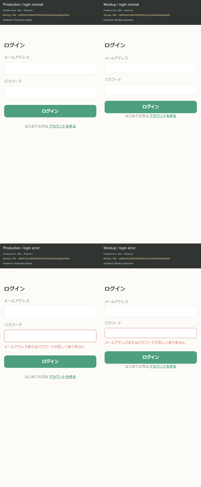
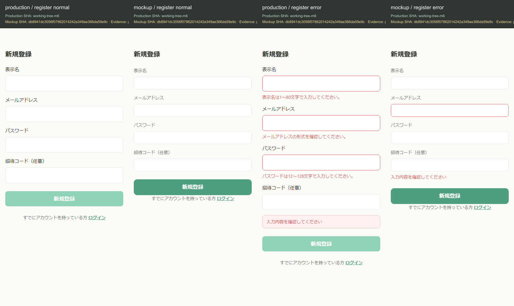
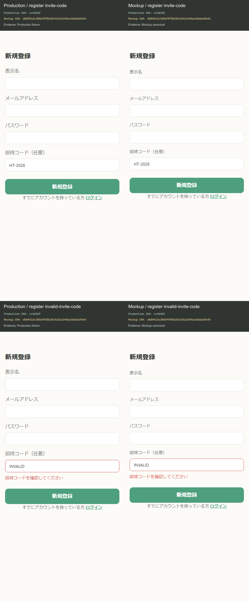
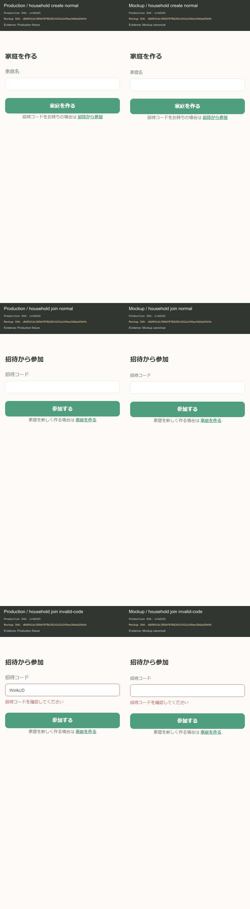

## Summary

M6 Auth / Household Entryの再レビュー対応です。Production / MockupのEntry visual parity 2点とMotion Evidenceの可読性だけを更新しました。Auth / invite backend/security contractは変更していません。

## Visual parity correction

- Entry scopeだけでProduction inputをMockup canonicalへ合わせました。390×844のPlaywright computed geometryで、Login / Register / Household Create / Household Join全routeを比較しています。
- Production / Mockupのinputは全routeで `39px`、`13px`、`padding: 10px 12px`、label→input `8px`。
- Production / Mockupのbutton bottom → secondary link topは全routeで `0px`。Entry以外のinput scopeは変更していません。
- `docs/evidence/m6/geometry.json` に9 Production + 9 Mockup stateのcomputed captureと、4 normal routeのparity assertion結果を保存しています。

## Production base SHA

`ed749b70707068b1b7dfb96e055d4e06371af094`

## Mockup reference SHA

`db8941dc3056f07862014242a349ae366da59e9c`

## Visual Evidence

Production render target SHA: `cc4d3d3`  
Evidence refresh commit: `af01341`

Boards remain vertical state blocks with `Production | Mockup` columns. Each panel includes state name, both SHAs, and Evidence source. Register error keeps the Production field-level validation detail and is labeled `Production validation detail`.

## Motion Evidence

The four flows keep the invalid/error state, corrected no-error state, and settled Home state readable with short 500–700ms waits. Register invite and Household Join assert `aria-invalid=false` before the valid submit. Login now asserts error clear after corrected credentials. Register/Create keeps Register complete, Create reached, household name complete, and Home settled.

Canonical WebM: [login-flow.webm](https://github.com/427harinn/HouseToDo/blob/af01341/docs/evidence/m6/motion/login-flow.webm), [register-create-household.webm](https://github.com/427harinn/HouseToDo/blob/af01341/docs/evidence/m6/motion/register-create-household.webm), [register-invite.webm](https://github.com/427harinn/HouseToDo/blob/af01341/docs/evidence/m6/motion/register-invite.webm), [household-entry.webm](https://github.com/427harinn/HouseToDo/blob/af01341/docs/evidence/m6/motion/household-entry.webm)

## Visual Deviations

- Backend/security/data semantics have no deviation and were not changed in this review.
- Register validation retains Production field-level display-name/email/password detail because these errors come from the existing Production validation contract. The Mockup canonical global error remains visible; this Production-only detail is labeled in `02-register.png` and `Evidence: Production validation detail`.
- No input font-size deviation is recorded: no explicit iOS auto-zoom requirement exists in the current Production contract, so Entry uses the canonical computed `13px` geometry.

## Tests

- `npm run lint` ✅
- `npm run typecheck` ✅
- `npm run build` ✅
- Targeted `src/App.test.tsx`: 25/25 ✅
- M6 Playwright: 5/5 ✅ (local `127.0.0.1:5173`)
- Worker invite validation targeted test: 1/1 ✅
- Evidence semantic capture: 9 + 9 states, computed geometry parity, focus-neutral, 4 actual interaction WebM ✅
- Full Vitest: 36 files / 232 passed / 1 pre-existing M2 fixture failure ⚠️ (`worker/app.test.ts` completedRecords expectation)
- Docker authenticated E2E: unavailable / not run; Docker hostname `app:5173` was not resolvable in this environment

## Reviewer upload package

`docs/evidence/m6/review-upload/` contains exactly 8 files: 4 labeled boards and 4 canonical WebM files. GIFs and individual captures are excluded.

## Deploy status

- staging deploy: not performed
- production deploy: not performed
- remote migration: not performed
- secrets/Cron: untouched
- PR merge: not performed
- M7: not started
