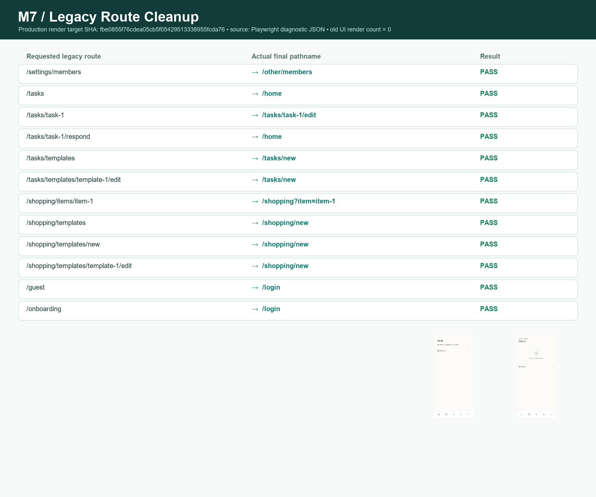
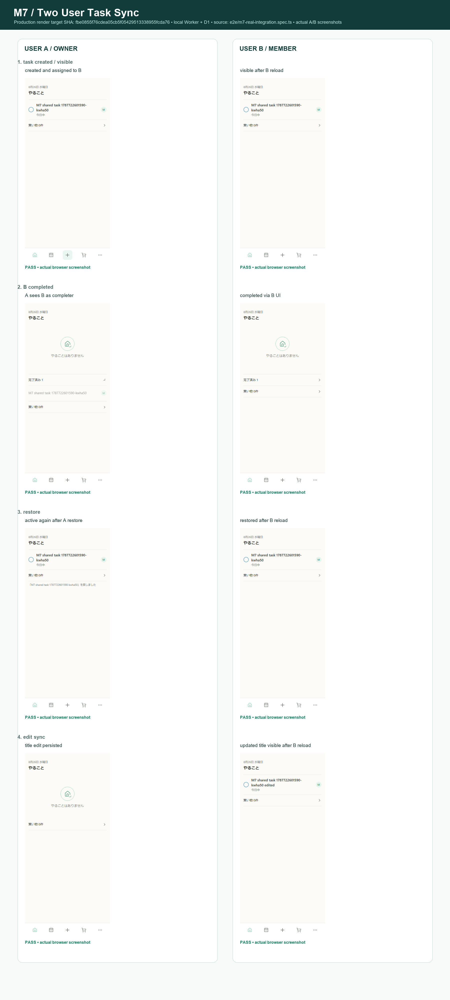
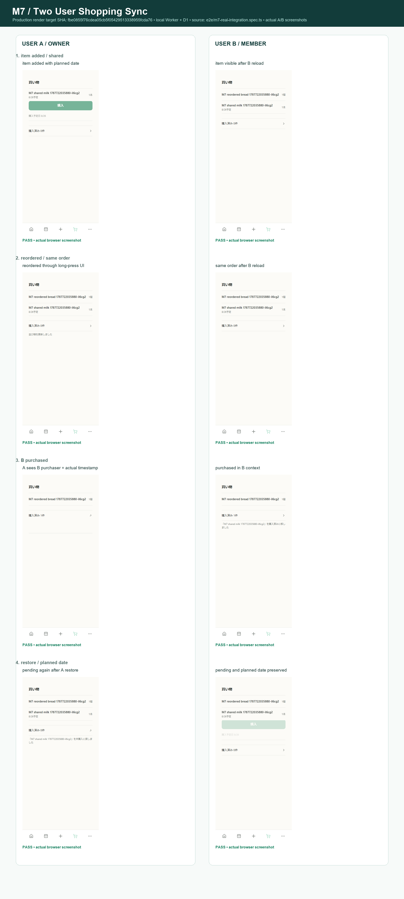
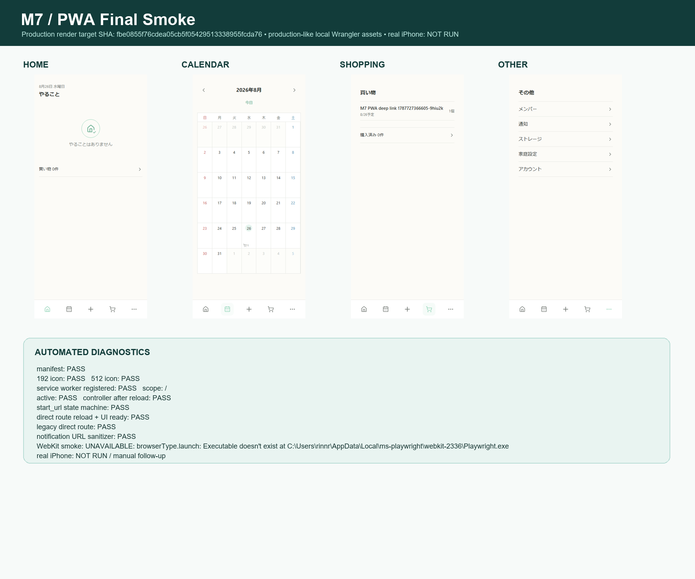
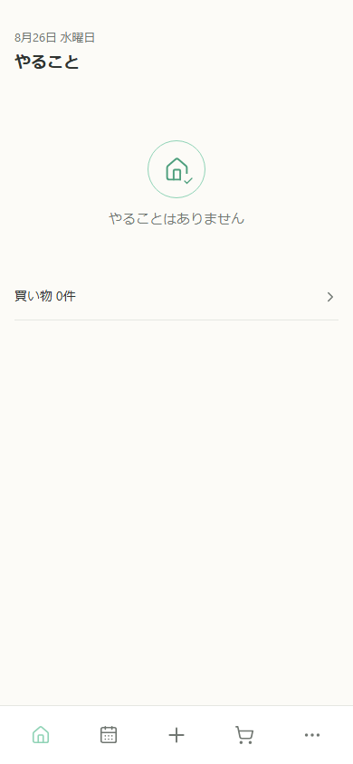
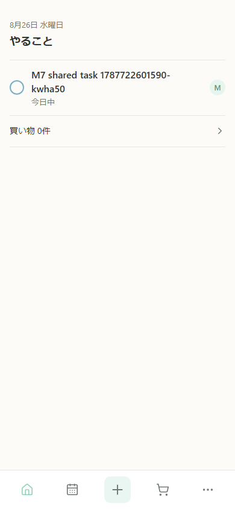
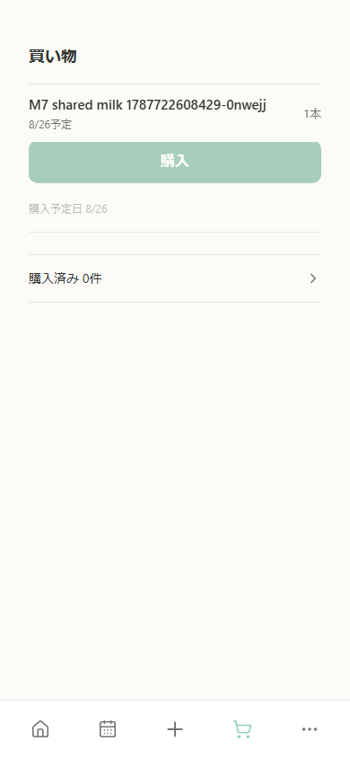
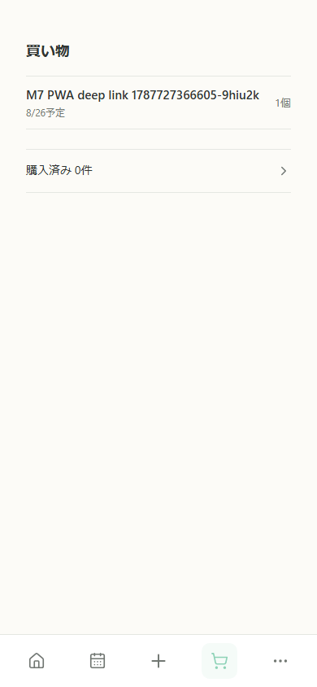

## Summary

M7 Integration / Legacy UI cleanup. Existing canonical M1–M6 UI remains the user-facing flow; legacy routes history-replace into canonical destinations. No visual redesign was introduced.

## Production base SHA

`d89a9d7ad52f5580b65a2a44b0e350295ef542c7`

## Mockup reference SHA

`db8941dc3056f07862014242a349ae366da59e9c`

## Production render target SHA

`fbe0855f76cdea05cb5f05429513338955fcda76`

## Evidence commit SHA

`75ce6e42ff4e9ecadcb1828a95d8bcd9a914fab7`

## Legacy Route Matrix

| Requested legacy route | Actual canonical pathname | Result |
| --- | --- | --- |
| `/settings/members` | `/other/members` | PASS |
| `/tasks` | `/home` | PASS |
| `/tasks/:taskId` | `/tasks/:taskId/edit` | PASS |
| `/tasks/:taskId/respond` | `/home` | PASS; no action executed |
| `/tasks/templates` | `/tasks/new` | PASS |
| `/tasks/templates/:templateId/edit` | `/tasks/new` | PASS |
| `/shopping/items/:itemId` | `/shopping?item=:itemId` | PASS |
| `/shopping/templates` | `/shopping/new` | PASS |
| `/shopping/templates/new` | `/shopping/new` | PASS |
| `/shopping/templates/:templateId/edit` | `/shopping/new` | PASS |
| `/guest`, `/onboarding` | M6 auth/household state redirect | PASS |

Playwright generated `docs/evidence/m7/diagnostics/legacy-route-results.json`; old UI render count was zero. The existing `legacyRedirectFor()` → `history.replaceState()` flow was preserved.

## Frontend cleanup

Legacy Task list/detail/respond/template, Shopping detail/template, and old Settings members screens are unreachable from user-facing routes. Canonical Task Add/Edit, Shopping Add/Edit, Calendar Shopping deep-link, Other, Auth, and Household Entry remain. Internal canonical navigation contains zero user-facing legacy destinations.

## Backend boundary

Worker legacy routes, template endpoints, services, repositories, D1 tables/columns, migrations, and compatibility response fields remain untouched for M8. No new migration was added.

## Two-user verification

Local Worker + local D1 + real session cookies + separate browser contexts:

- Task: A created/assigned to B; B saw it after reload; B completed; A saw B as completer; A restored; B saw active; A edited and B saw the updated title. A separate real pass test used B's pointer swipe and A saw the same task in Passed; Production history returned skipped with B as actor.
- Shopping: A added a planned item; B saw it; A long-press reordered and B saw the same order; B purchased; A saw purchaser B and actual API `purchasedAt` matching the UI; A restored and B saw pending with planned date preserved.
- Calendar: both-user planned-date data showed the marker and Date Sheet Shopping; UI navigation reached `/shopping?item=<actual-id>` and expanded the target row.
- Other/permission: same two-member list; B displayName refresh synced to A; owner household name/timezone update synced to B; member update was denied/read-only.
- Session isolation: A logout reached `/login`; B remained authenticated and used canonical Home.

## PWA verification

`docs/evidence/m7/diagnostics/pwa-results.json` was generated by the production-like local Wrangler asset server. Manifest 200/required fields, 192/512 icon dimensions, service-worker registration/scope/active/controller, all three start URL states, direct route reloads with canonical UI/data settled (`httpOk` + `uiReady`), actual Shopping deep-link expansion, `/tasks` legacy redirect, and notification sanitizer result passed. WebKit is `UNAVAILABLE` because its Playwright executable is not installed. Real iPhone is `NOT RUN`; see `docs/PWA_MANUAL_CHECKLIST.md`.

## Visual Evidence

## Motion Evidence

Canonical WebM files are in the pinned `review-upload` package at the Evidence commit.

## Test debt resolution

The stale M2 Home fixture, Calendar selectors/fixtures, and Shopping selectors/fixtures were aligned to the final canonical contract. Full Vitest is green; no unrelated backend behavior was rewritten.

## Tests

- `npm run lint`: PASS
- `npm run typecheck`: PASS
- `npm run build`: PASS
- `npm test -- --reporter=dot`: PASS, 37 files / 236 tests
- `npm run db:migrate:local`: PASS, no pending local migrations; remote untouched
- M7 legacy route Playwright: PASS, 2/2
- M7 real two-user integration Playwright: PASS, 4/4; combined legacy + integration: 6/6
- Full canonical local Chromium Playwright: PASS, 38/38 at 390x844
- M7 PWA production-like check: PASS; WebKit UNAVAILABLE
- Changed-source format comparison: repository baseline remains non-green; M7 changed legacy/integration source files had the same baseline Prettier failure profile, and new capture/diagnostic scripts are formatted.

## Deviations / Manual follow-up

Docker daemon and WebKit executable were unavailable. Avatar/R2 sync was not run because no safe local image/R2 fixture was available; required displayName sync and all owner/member permissions were verified. Real iPhone checks remain manual and unrun. Offline-first behavior was not added or claimed.

## Reviewer upload package

`docs/evidence/m7/review-upload/` contains exactly 8 files: 4 PNG boards and 4 final side-by-side/canonical WebM videos. Raw A/B videos, GIF previews, diagnostics, screenshots, and traces are outside the upload directory.

## Deploy status

- staging deploy: not performed
- production deploy: not performed
- remote migration: not performed
- secrets/Cron: untouched
- PR merge: not performed
- M8: not started
