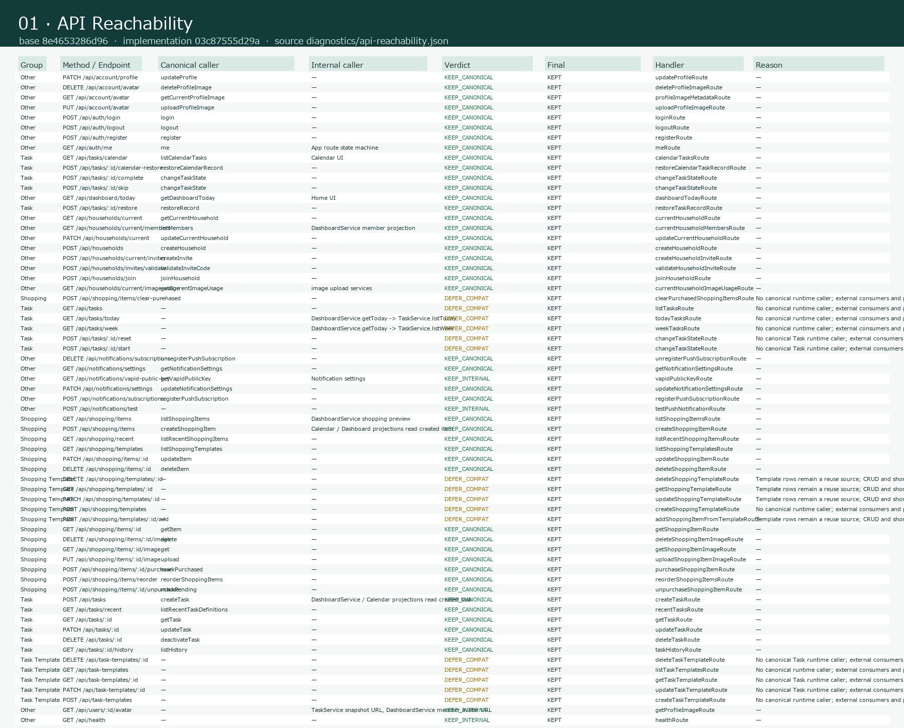
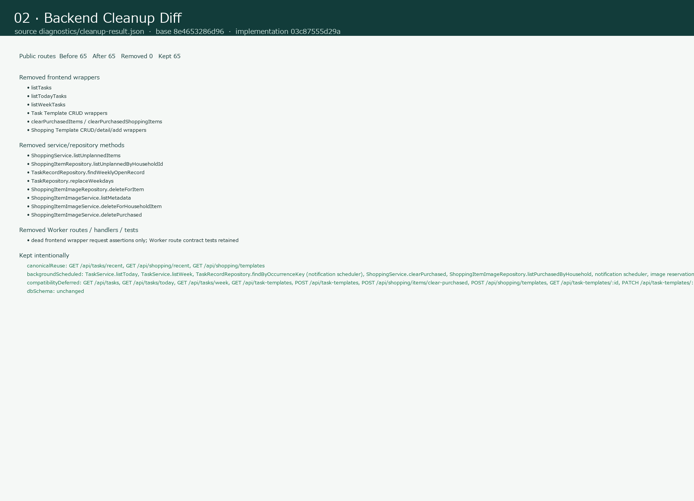
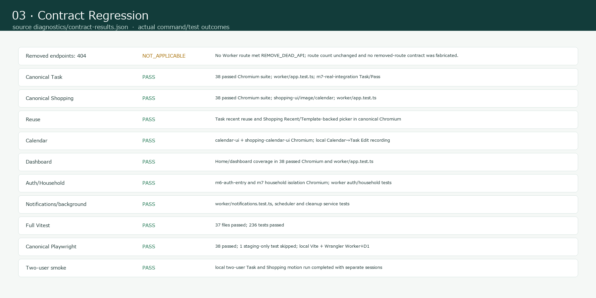
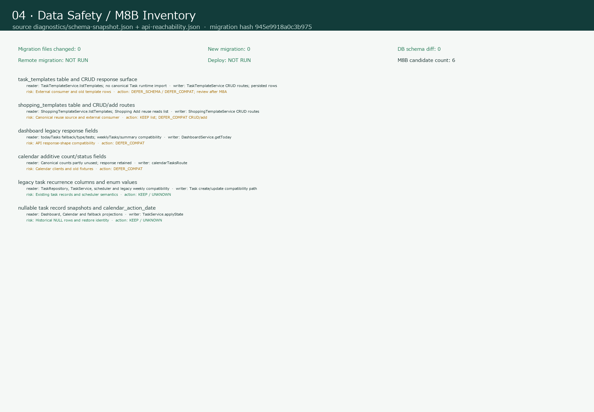
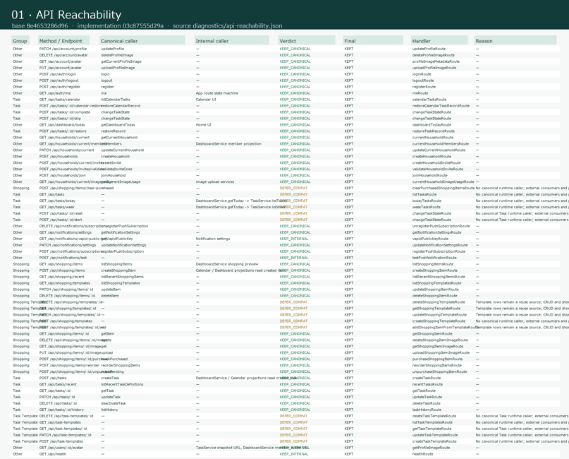
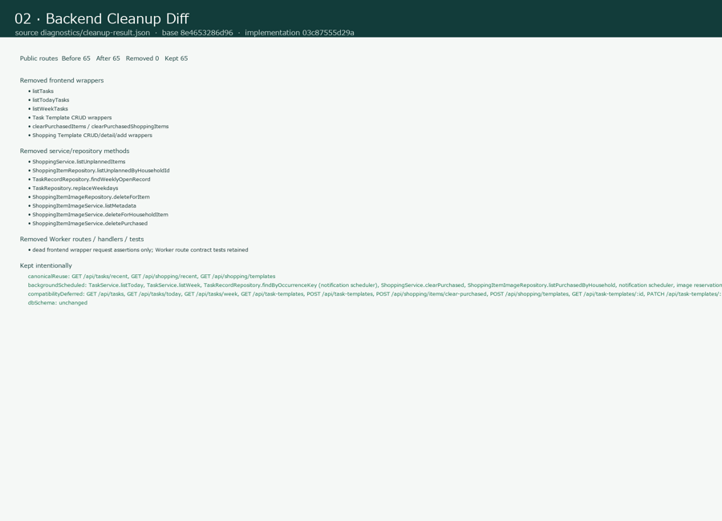
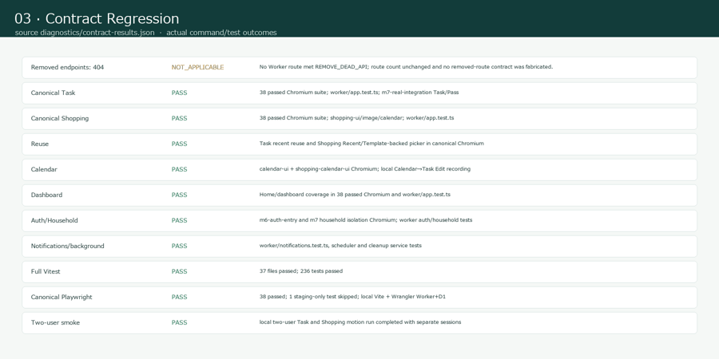
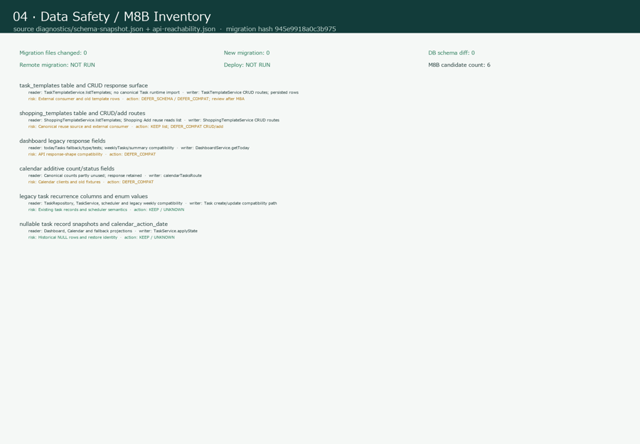

## Summary

M8A audits the complete Worker public API surface and removes only source-local dead frontend wrappers and unreferenced internal helpers. No Worker route was removed because the repository cannot prove the absence of external consumers. Canonical Task, Calendar, Dashboard, Shopping, reuse, Auth, Household, notification, image, PWA, and scheduled contracts remain protected.

## Production base SHA

`8e4653286d964f1ef88be6da92ad7b11e9c21ed5`

Implementation SHA: `03c87555d29ab6e8bb60b8f4fcdeb490bb013d83`

## Audit methodology

The generated matrix starts from every route registered in `worker/app.ts` and traces handler, service, repository, frontend caller, internal Worker caller, scheduled caller, E2E caller, and test-only caller. Searches covered `src/`, `worker/`, `e2e/`, `scripts/`, `public/sw.js`, `worker/index.ts`, API wrapper names, endpoint strings, handler names, service methods, and repository methods.

## API Reachability Matrix

Machine-readable source: `docs/evidence/m8a/diagnostics/api-reachability.json`

- `KEEP_CANONICAL`: 45 routes
- `KEEP_INTERNAL`: 4 routes
- `DEFER_COMPAT`: 16 routes
- Public routes: 65 before / 65 after / 0 removed

## Removed backend surface

- Frontend wrappers: 6 grouped cleanup entries, including task list/today/week and Task Template CRUD wrappers, Shopping clear-purchased and Shopping Template CRUD/detail/add wrappers.
- Internal methods: 8; 4 service methods and 4 repository methods.
- Worker routes: 0.
- Route handlers: 0.
- Legacy tests: only dead frontend wrapper request assertions were removed; Worker contract tests remain.

## Intentionally kept

- Template/reuse: Shopping template list and `ShoppingTemplate` type; all Worker template routes remain deferred; Task recent reuse remains canonical.
- Background/scheduled: notification scheduler, occurrence lookup, image reservation cleanup, orphan R2 cleanup, and shared Dashboard task queries.
- Compatibility: Dashboard and Calendar additive response fields remain `DEFER_COMPAT`.
- Schema: all tables, columns, indexes, persisted values, and migration history remain unchanged.

## DB safety

Schema diff = 0. Migration files changed = 0. New migrations = 0. Local migration check reported `No migrations to apply!`. Remote migration and deploy were not run.

## M8B candidates

Six candidates are recorded with current reader, current writer, migration requirement, risk, and recommended action in `docs/evidence/m8a/diagnostics/api-reachability.json`: template schema/CRUD compatibility, Shopping template compatibility, Dashboard fields, Calendar additive fields, legacy recurrence values, and nullable historical task-record fields.

## Regression verification

Removed endpoints: not applicable; zero routes met `REMOVE_DEAD_API`.

## Visual Evidence

## Motion Evidence

 [canonical WebM](./motion/task-regression.webm)

 [canonical WebM](./motion/calendar-task-regression.webm)

 [canonical WebM](./motion/shopping-regression.webm)

 [canonical WebM](./motion/app-smoke-regression.webm)

## Tests

- `npm run lint` — PASS
- `npm run typecheck` — PASS
- `npm test` — 37 files / 236 tests PASS
- `npm run build` — PASS
- `npm run db:migrate:local` — PASS, no migrations to apply
- changed JavaScript source/evidence scripts format check — PASS; Python evidence generator `py_compile` — PASS
- canonical Chromium — 38 passed, 1 staging-only skipped, local Vite + Wrangler Worker/D1
- two-user Task and Shopping smoke — PASS with separate sessions
- removed-route contract — not applicable, no route removed

## Reviewer upload package

`docs/evidence/m8a/review-upload/` contains exactly four PNG boards and four WebM files; no JSON, GIF, raw screenshot, trace, or HTML report is included.

## Deploy status

- staging deploy: not performed
- production deploy: not performed
- remote migration: not performed
- secrets/Cron: untouched
- PR merge: not performed
- M8B: not started
